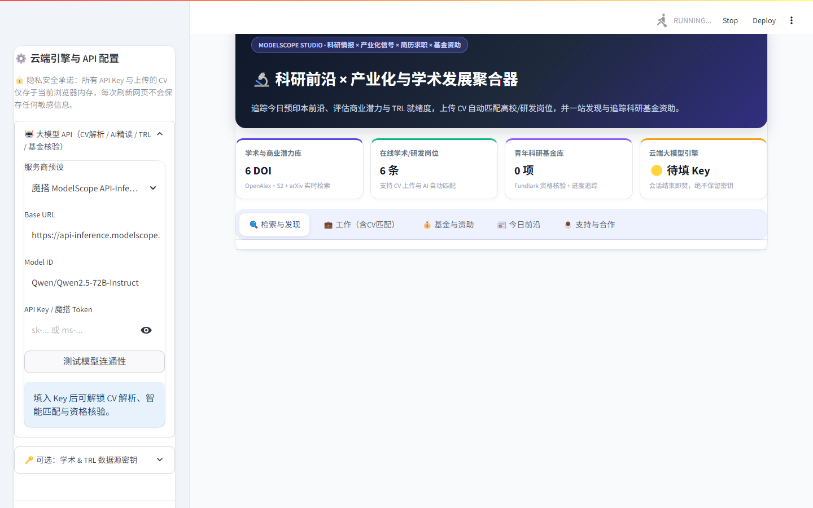

# acad-job · 科研前沿 × 产业化 × 学术求职与基金聚合器

**一个 Streamlit 单文件应用**：把「学术文献检索 → 产业化信号（arXiv 趋势 / 专利 / TRL）→ 学术岗位聚合与 CV 匹配 → 青年科研基金追踪」串成一条主线，帮助科研求职者、青年 PI 和产业化分析师在同一个界面里完成「看方向、看机会、看钱」。



## 功能一览

| 模块 | 标签页 | 做什么 |
|------|--------|--------|
| 检索与发现 | 🔍 | 中英文自然语言检索论文（OpenAlex / Semantic Scholar / arXiv 去重合并），自动注入商业潜力分级、arXiv 90 天趋势与 PatentsView 专利信号，支持结果导出 CSV |
| 工作与 CV 匹配 | 💼 | 静态精选岗位库 + 实时 RSS 学术岗位流，支持上传简历（PDF/DOCX/TXT）由大模型解析画像，并与岗位做硬过滤 + 软排序匹配，输出可解释匹配理由 |
| 基金与资助 | 💰 | 青年科研基金库（NSFC 青年项目等），支持资格筛选、资格核验与进度追踪，可上传自定义基金清单 |
| 今日前沿 | 📰 | 每日拉取 arXiv / bioRxiv / medRxiv 最新预印本，按领域分桶速览 |
| 支持与合作 | ☕ | 作者联系方式与赞赏码，以及运行环境数据状态面板 |

## 项目结构

```text
acad-job/
├── app.py                      # Streamlit 入口（页面配置、缓存、标签页编排）
├── requirements.txt            # Python 依赖
├── gitignore.txt
├── assets/
│   ├── coffee_qr.png           # 赞赏码
│   └── app_screenshot.png      # README 界面截图
├── data/                       # 静态数据（可被环境变量覆盖路径）
│   ├── academic_jobs.csv       # 精选岗位库（标题/机构/地点/薪资/截止日期/标签/链接）
│   ├── research_grants.csv.csv # 青年基金库（资助方/阶段/金额/资格/截止）
│   └── commercial_potential.csv # 商业潜力切片索引（DOI → 分级）
├── src/
│   ├── academic_api.py         # OpenAlex / Semantic Scholar / arXiv 检索与去重
│   ├── industrial_signals.py   # arXiv 90 天趋势、PatentsView 专利信号、TRL 评估
│   ├── job_signals.py          # 静态岗位加载、RSS 岗位流、岗位过滤
│   ├── grant_signals.py        # 基金加载、过滤、资格初筛、OpenAlex 资助方
│   ├── cv_matcher.py           # 简历文本抽取与岗位匹配（硬过滤 + 软排序）
│   ├── llm_client.py           # 大模型客户端（兼容 OpenAI 协议的预设）
│   ├── ui_components.py        # 侧边栏、KPI、论文卡片、岗位/基金/前沿渲染组件
│   ├── styles.py               # 自定义 CSS、Hero、页脚、头部样式
│   ├── config.py               # 环境变量与侧边栏会话配置聚合
│   └── src__init__.py          # src 包标记
├── scripts/
│   ├── prepare_compot_csv.py   # 生成商业潜力切片 CSV
│   └── scaffold_phase1.py      # 早期 Gradio 骨架（历史模板，已被现应用取代）
├── SKILL.md                    # Skill 说明（能力边界与调用方式）
├── agents/openai.yaml          # Codex 自动发现元数据
└── references/architecture.md  # 数据源、Schema 与合规细节
```

## 快速开始

```bash
pip install -r requirements.txt
streamlit run app.py
```

默认打开 `http://localhost:8501`。所有 API Key 均可在**左侧边栏**现场填写（仅存于会话内存，关闭即焚），也可用环境变量预置：

| 环境变量 | 用途 | 必需性 |
|----------|------|--------|
| `OPENALEX_API_KEY` | OpenAlex 检索（含邮箱 polite pool） | 可选 |
| `SEMANTIC_SCHOLAR_API_KEY` | Semantic Scholar 检索 | 可选 |
| `APIFY_API_TOKEN` | TRL 产业化评估 Actor | 可选 |
| `PATENTSVIEW_API_KEY` | 专利信号 | 可选 |
| `COMPOT_CSV_PATH` | 商业潜力切片路径，默认 `data/commercial_potential.csv` | 可选 |
| `JOBS_CSV_PATH` | 静态岗位库路径，默认 `data/academic_jobs.csv` | 可选 |
| `GRANTS_CSV_PATH` | 基金库路径，默认 `data/research_grants.csv.csv` | 可选 |
| 侧边栏 LLM Key | 简历解析 / 岗位匹配 / 基金资格核验 / 论文摘要 | 用 AI 功能时必需 |

> 无任何 Key 时应用仍可启动，静态数据与检索可用，AI 相关功能显示「待填 Key」。

## 数据与检索流程

1. **文献检索**：`search_academic_papers()` 并发查询 OpenAlex / Semantic Scholar / arXiv，按 DOI 去重合并，附引用数与来源徽章。
2. **产业化注入**：用 `commercial_potential.csv` 给每篇论文打商业潜力分级，叠加 arXiv 90 天趋势与 PatentsView 专利信号，形成「学术热度 → 产业信号」视图。
3. **岗位匹配**：静态岗位库 + RSS 岗位流合并去重；上传简历后由 LLM 抽取学术画像，先做硬过滤（职位级别 / 地域 / 截止日期），再软排序（研究方向语义相似度 + 发表/技能匹配），输出 0–100 分与可解释理由。
4. **基金追踪**：静态基金库 + OpenAlex 资助方补充，按阶段/地区/资格过滤，LLM 可做资格初核。

## 部署

- **本地**：`streamlit run app.py`
- **ModelScope Studio / Streamlit Cloud**：入口文件设为 `app.py`，持久化目录用 `/mnt/workspace/data`，敏感信息走平台 Secrets，不要写入仓库。

## 合规与边界

- 职位与基金数据来自公开来源与第三方接口，不保证实时性与完整性，申请前以原始链接为准。
- 遵守目标站点 `robots.txt` 与 crawl-delay。
- AI 功能仅辅助判断（匹配建议、资格初核、摘要），不代写求职信正文，不修改用户简历内容；最终决定权在用户。
- 密钥只保存在会话内存或环境变量，绝不出现在代码与提交历史中。

## 贡献与支持

作者：xingguangYan（xingguangyan0703@gmail.com）。如本项目对你有帮助，欢迎在「☕ 支持与合作」标签页扫码支持。

## 版本历史

- v2.0：重构为 Streamlit 应用「科研前沿 × 产业化 × 学术求职与基金聚合器」，新增文献检索、产业化信号、基金模块与 CV 匹配
- v1.0：AcademicJobsOnline 适配器 + Gradio 前端骨架（`scripts/scaffold_phase1.py` 保留为历史模板）

## 许可

Apache License 2.0
